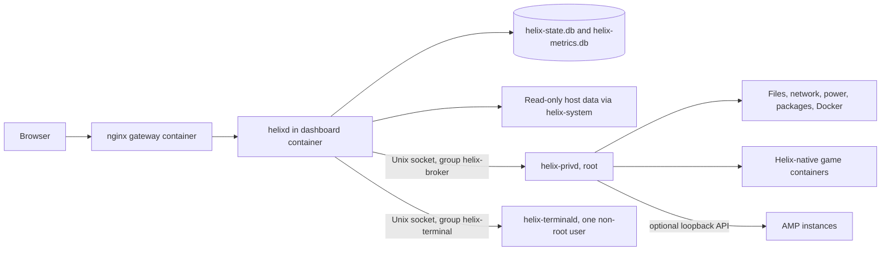

# Architecture

This page is the technical map of Helix 1.10: the Rust crates, the frontend,
where data lives, which process runs with which privileges, and how a request
moves through the system. For a plain-language tour, start with
[How Helix Works](https://github.com/Riqqqque/Helix/wiki/How-Helix-Works).

## Workspace crates

The Cargo workspace (`Cargo.toml`) has twelve members. All share version
`1.10.0`, edition 2024, `rust-version = "1.88"`, and the
`AGPL-3.0-or-later` license. `unsafe_code` is forbidden workspace-wide.

| Crate | Builds | Role |
| --- | --- | --- |
| `helix-core` | library | Shared, platform-neutral domain models and the Helix version constant. |
| `helix-auth` | library | Login-name identity, password policy, bounded Argon2id hashing, and opaque-token primitives. No HTTP, SQL, or async runtime. |
| `helix-config` | library | Typed `helixd` configuration with conservative production defaults. |
| `helix-state` | library | SQLite durability domains: critical state and metrics databases, migrations, integrity checks, sessions, server API tokens, machines, Strands, appearance, and security state. |
| `helix-secrets` | library | XChaCha20-Poly1305 envelope encryption for recoverable secrets. The caller supplies the master key in memory. |
| `helix-strand-kit` | library | Strand scaffolding, strict `strand.toml` validation, and `helix.strand/1` zip pack/unpack. |
| `helix-system` | library | Narrow read-only host discovery: CPU, memory, disks, mounts, interfaces, routes, services, processes. |
| `helix-api` | library | The versioned `/api/v1` HTTP API, authentication middleware, static asset serving, terminal bridge, Strand host calls, weather proxy, server API tokens, and the token vault. |
| `helix-privd` | library + binary | The library is the closed broker protocol (`BrokerRequest` and friends) shared with `helixd`. The `helix-privd` binary is the root broker; its host modules (files, native servers, network, packages, hooks, updater, machines hub, AMP, Docker) compile only on Linux. |
| `helix-terminal` | library + binary | The library is the length-bounded terminal protocol (version 2). The `helix-terminald` binary is the non-root PTY bridge (Unix only). |
| `helixd` | binary | Wires configuration, state, the API, and the HTTP server together and supervises shutdown. |
| `helixctl` | binary | Local admin CLI: `setup-token`, `status`, `ready`, `doctor`, `backup-state`, and `strand new / check / pack / inspect`. |

Dependencies point inward toward `helix-core`. `helix-api` depends on the
`helix-privd` library only for protocol types; it never links the broker's
host modules.

## Frontend structure

The dashboard is a static Preact 10 + TypeScript app built by Vite into
`frontend/dist`. `helixd` serves those files; Node.js is a build tool only.

- `frontend/src/main.tsx` boots the app; `app.tsx` holds the shell (sidebar,
  top bar, mobile bar, background-operation tray) and picks the page from the
  URL fragment (`navigation.ts`).
- Each page is a `*-route.tsx` wrapper that lazy-loads its module, so the
  first load stays small. Hovering or focusing a sidebar link preloads it.
- `*-api.ts` files are typed API clients that validate every response before
  the UI uses it.
- `dashboard-preferences.ts`, `use-dashboard-preferences.ts`, and
  `preferences-api.ts` handle revisioned preference sync.
- `home*.ts(x)` is the Home grid editor; `strand-frame.tsx` hosts Strand
  iframes; `terminal*.tsx` wraps xterm.js.
- Tests are Vitest files next to the code (`*.test.ts(x)`).

## Data stores

### Dashboard data directory

`helixd` keeps its own data under its data directory (`/var/lib/helix` inside
the dashboard container, bind-mounted from `HELIX_DATA_DIR` on the host).

| Path | Contents |
| --- | --- |
| `state/helix-state.db` | Critical state: owner, roles and capabilities, sessions (hashed), audit rows, dashboard preferences and Home layouts, server API tokens, machines, installed Strands and their KV data, appearance. SQLite WAL, `synchronous=FULL`. Schema version 11. |
| `state/migration-backups/` | Verified snapshots taken before a schema migration. |
| `metrics/helix-metrics.db` | Replaceable metrics. A corrupt file is moved aside into a forensic folder and recreated without blocking login. |
| `secrets/token-vault.key` | Master key for the token vault, which keeps an encrypted copy of each server API token so the owner can view it again. It sits outside `state/`, so a copied state database or a `helixctl backup-state` snapshot does not reveal tokens. |

### Broker roots

`helix-privd` reads `/etc/helix/privd.json`
([example](https://github.com/Riqqqque/Helix/blob/main/deploy/privd.example.json)).
The main keys are `socket`, `amp_credentials`, `managed_roots`,
`analysis_roots`, `host_control`, `native`, `network`, `packages`,
`hook_installer`, `helix_update`, and `hub`.

The native **state root** (`native.state_root`, for example
`/srv/helix/state/instances`) holds the broker's records for Helix-owned
servers:

| Entry | Contents |
| --- | --- |
| `<id>.json` | The server manifest: game, software, ports, `run_uid`, backup policy, start-after-boot choice. |
| `jobs.json` | Background job records (at most 64), written atomically with mode `0600`. |
| `pending/<id>/` | Staged file changes for a running server, indexed by `pending.json` (at most 500 entries). |
| `console/<id>/` | Rotating console history segments. |
| `.staging/` | Temporary trees for runtime and server installs. |
| `server-trash/` | Removed native servers that can still be restored. |
| `imports/` | Working area for copying servers in from other managers. |
| `metadata/` | Cached catalog metadata. |
| `curseforge-api-key` | The owner's CurseForge API key, kept only on this host. |
| `backup-trash-expiry-since` | When automatic backup-trash expiry first ran, so older trash is not purged on upgrade. |
| `.docker-cli/` | An isolated Docker CLI home so broker calls never touch a personal Docker config. |

Server files live under `native.instance_root/<id>` and backups under
`native.backup_root/<id>`. Update staging lives in `/var/lib/helix/updates`
and Docker-cleanup records in `/var/lib/helix/docker-cleanup`
(both created by `deploy/helix-tmpfiles.conf`).

Each native server gets its own **run_uid** between 20000 and 59999. Its
container runs as `--user <run_uid>:<run_uid>` and its files are owned by
that ID, so two servers cannot read each other's data.

## Process and privilege boundaries

| Process | Runs as | Talks to | Notes |
| --- | --- | --- | --- |
| gateway (nginx) | UID 101 in its own container | `helixd` on `127.0.0.1:8080` | Shares the dashboard's network namespace. Checks the exact Host, Origin, and client CIDR. 15-second proxy timeout, 8 hours for terminal WebSockets. |
| `helixd` | UID 10001, read-only container, all capabilities dropped, 128 MiB memory | broker and terminal sockets | Holds sessions and capabilities. Never runs shell commands. |
| `helix-privd` | root, systemd `helix-privd.service`, group `helix-broker` | Docker, systemd, APT, UFW, files | Accepts only the closed `BrokerRequest` enum over `/run/helix/privd.sock` (mode `0660`). Access comes from membership in the socket's group, which the dashboard container gets through `group_add`. Requests are capped at 5 MiB, responses at 32 MiB. |
| `helix-terminald` | one configured non-root user, `helix-terminald@<user>.service`, group `helix-terminal` | a PTY login shell | Checks the connecting UID with Linux peer credentials (`--allowed-peer-uid 10001`). Up to 8 sessions at once. |
| game containers | their own `run_uid` | nothing in Helix | Keep running when the dashboard, gateway, or broker restarts. |

The broker's systemd unit uses `ProtectSystem=strict`, `NoNewPrivileges`, and
an explicit `ReadWritePaths` list. Add extra storage roots with a drop-in
rather than loosening the unit.

### systemd units

| File | Purpose |
| --- | --- |
| [`deploy/helix-privd.service`](https://github.com/Riqqqque/Helix/blob/main/deploy/helix-privd.service) | The root broker. |
| [`deploy/helix-terminald@.service`](https://github.com/Riqqqque/Helix/blob/main/deploy/helix-terminald@.service) | Optional terminal bridge, one instance per Linux user. |
| [`deploy/helix-finalize-update.service`](https://github.com/Riqqqque/Helix/blob/main/deploy/helix-finalize-update.service) | One-shot unit that installs a staged update, restarts the broker, and rolls back on failure. |
| [`deploy/helix-privd.docker-sock.conf`](https://github.com/Riqqqque/Helix/blob/main/deploy/helix-privd.docker-sock.conf) | Drop-in that restores Docker socket access on hosts with a customized broker unit. |
| [`deploy/helix-tmpfiles.conf`](https://github.com/Riqqqque/Helix/blob/main/deploy/helix-tmpfiles.conf) | Creates `/run/helix`, `/run/helix/terminal`, `/run/helix/hook-installs`, and the update and cleanup state folders. |

## Container images

The [Dockerfile](https://github.com/Riqqqque/Helix/blob/main/Dockerfile) has
these targets:

| Target | Base | Output |
| --- | --- | --- |
| `frontend-build` | `node:24-bookworm-slim` | Runs `npm ci` and `npm run build`. |
| `rust-build` | `rust:1.88-bookworm` | Builds `helixd`, `helixctl`, `helix-privd`, and `helix-terminald` in release mode. |
| `linux-test` | `rust-build` | Runs fmt, Clippy with `-D warnings`, the full test suite with `--include-ignored`, and the server API smoke test. |
| `privd` | `scratch` | Just the `helix-privd` binary, for installing on the host. |
| `terminald` | `scratch` | Just the `helix-terminald` binary. |
| `dashboard-layout` | `debian:bookworm-slim` | Assembles the file tree for the dashboard image. |
| `dashboard` | distroless `base-nossl-debian12:nonroot` | `helixd` and `helixctl`, the compiled web assets, and `deploy/helix-container.toml`. Runs as 10001 on port 8080. |
| `gateway` | `nginx-unprivileged` (Alpine) | The LAN gateway with `deploy/nginx/default.conf.template`. Listens on 3000. |

[`compose.yaml`](https://github.com/Riqqqque/Helix/blob/main/compose.yaml)
runs `dashboard` and `gateway` on a private bridge network with
inter-container traffic disabled. Game runtime images (Valheim, V Rising,
Terraria, Hytale, and others) are built from folders under
`crates/helix-privd/`.

## Request lifecycle

1. The browser sends a request to the gateway. nginx returns 421 for an
   unknown Host and 403 for a wrong Origin or a client outside the allowed
   CIDRs.
2. nginx proxies to `helixd` on loopback.
3. `helix-api` checks the session cookie, the `X-Helix-CSRF` proof, and the
   capability for that route. Default deny.
4. Read-only data comes from `helix-system` or the state database.
5. Root-required work becomes one `BrokerRequest` sent over the broker socket.
   The broker revalidates IDs, paths, and state on its own. It does not trust
   checks done in `helixd`.
6. Long work returns a job ID. The browser stores that receipt and polls it,
   so a reload reattaches instead of repeating the action.
7. Results come back as bounded JSON with explicit failure states.

## Capabilities

The owner role holds every capability. Routes check them server-side; the list
the browser sees is for display only.

| Capability | Gates |
| --- | --- |
| `system.view` | Overview, host data. |
| `system.settings.write` | Hooks actions, Strands install, Docker cleanup, host integration, server tokens. |
| `system.power` | Host reboot and schedules. |
| `system.packages.read`, `system.packages.write` | Package list and Apply. |
| `storage.files.read`, `storage.files.manage`, `storage.analyze` | File manager and analyzer. |
| `network.firewall.read`, `network.firewall.write` | UFW rules and activation. |
| `games.view`, `games.manage`, `games.backups.manage` | Servers, backups. |
| `terminal.open` | Host terminal. |
| `machines.view`, `machines.manage` | Machines page. |
| `users.manage` | Session expiry setting. |

## Architecture decision records

| ADR | Decision |
| --- | --- |
| [0001 Component boundaries](https://github.com/Riqqqque/Helix/blob/main/docs/adr/0001-component-boundaries.md) | One small resident unprivileged daemon, with separate processes only where privilege, untrusted code, heavy work, or workload lifetime requires it. Games never depend on the dashboard process. |
| [0002 SQLite durability domains](https://github.com/Riqqqque/Helix/blob/main/docs/adr/0002-sqlite-durability-domains.md) | Two SQLite files: critical state with full durability, metrics with relaxed durability. Large data stays on the filesystem. No database server. |
| [0003 Frontend framework](https://github.com/Riqqqque/Helix/blob/main/docs/adr/0003-frontend-framework.md) | Preact, TypeScript, and Vite for a small static frontend. Accepted provisionally, with a measurement gate. |
| [0004 Owner authentication](https://github.com/Riqqqque/Helix/blob/main/docs/adr/0004-owner-authentication.md) | Opaque server-side sessions stored as hashes, a single-use bootstrap token from `helixctl`, Argon2id passwords, a CSRF proof on every protected route. |
| [0005 Recoverable secret storage](https://github.com/Riqqqque/Helix/blob/main/docs/adr/0005-recoverable-secret-storage.md) | Per-record XChaCha20-Poly1305 envelopes with a separate master key. Rotation and independent recovery are not built yet. |

## Design-only parts

Some documents describe parts that do not exist in the code yet. Treat them
as plans:

- `helix-worker` (one-shot job worker) and `helix-strandd` (Wasm Strand host)
  are not crates.
- [Sequences](https://github.com/Riqqqque/Helix/blob/main/docs/SEQUENCES.md),
  a declarative game-package format, have no parser or engine.
- [Genome](https://github.com/Riqqqque/Helix/blob/main/docs/GENOME.md), a
  portable export format, has no exporter or importer.
- The general operation ledger, low-disk guard, and Vault backup backends in
  [docs/ARCHITECTURE.md](https://github.com/Riqqqque/Helix/blob/main/docs/ARCHITECTURE.md)
  and [docs/STORAGE.md](https://github.com/Riqqqque/Helix/blob/main/docs/STORAGE.md)
  are contracts, not finished features.

## Related pages

- [How Helix Works](https://github.com/Riqqqque/Helix/wiki/How-Helix-Works)
- [Development and Testing](https://github.com/Riqqqque/Helix/wiki/Development-and-Testing)
- [Security and Recovery](https://github.com/Riqqqque/Helix/wiki/Security-and-Recovery)
- [Glossary](https://github.com/Riqqqque/Helix/wiki/Glossary)
