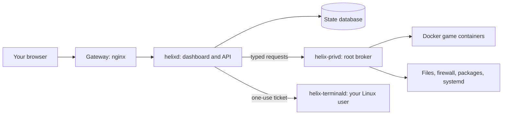

# How Helix Works

Helix is a private web dashboard for one Linux host and the game servers on it.
This page walks through what happens when you click something: who handles
the request, who is allowed to touch the host, and how Helix keeps two actions
from colliding on the same server. For crate names, file layouts, and units,
see [Architecture](https://github.com/Riqqqque/Helix/wiki/Architecture).

> [!CAUTION]
> Helix is a private-LAN release. Keep it on a network you control. Do not
> publish the dashboard port to the internet.

## The pieces

| Piece | What it does | Runs as |
| --- | --- | --- |
| Gateway | An nginx container in front of everything. It only answers for the exact host name, browser origin, and client network you configured. | Unprivileged nginx |
| `helixd` | Serves the dashboard, checks your session, and answers the API. It reads host health directly but cannot change the host. | Unprivileged user in a read-only container |
| `helix-privd` | The broker. It does everything that needs root: Docker, files, firewall rules, packages, reboots, updates. | root, as a systemd service |
| `helix-terminald` | Optional. Gives the Terminal page a real shell. | One normal Linux user you choose |
| Game containers | Each Helix-owned game server runs in its own Docker container with its own user ID. | That server's own user ID |

The key rule is that `helixd` never runs a command string. When it needs root,
it sends the broker one item from a fixed list of typed requests, such as
"start server X" or "move this file to trash". The broker checks the request
again on its own: the server ID, the path, the current state. There is no
request that means "run this command as root".

## A click, start to finish

Say you press **Start** on a server.

1. Your browser sends the request to the gateway. A wrong host name gets 421,
   a wrong origin or network gets 403.
2. The gateway passes it to `helixd` on the same machine.
3. `helixd` checks your session cookie, the CSRF proof that goes with it, and
   that your account has the `games.manage` capability.
4. `helixd` sends a typed request to the broker over a local Unix socket.
5. The broker takes the server's operation lock, starts the container, and
   reports progress as a job.
6. The dashboard shows the job in the **Background activity** tray and polls
   it every second until it finishes.

If you reload the page in the middle, the browser still has the job ID. It
picks up the same job instead of pressing Start again.

## Sessions

- Signing in creates a session. The cookie holds a random token; the database
  holds only its hash.
- By default a session ends after 30 minutes idle or 8 hours total. **Settings
  → Signed-in session → Stay signed in** keeps it until you sign out or change
  the password.
- Every protected request also needs a CSRF proof. The browser keeps that
  proof for this exact origin, so a reload keeps you signed in but never
  extends the server's deadline.
- Changing the login name or password signs out every session, including the
  current one.

## Jobs

Anything that can take longer than one request is a job: creating a server,
updates, backups, restores, deploys, marketplace installs, transfers, hook
installs, package changes, and Helix updates.

- A job moves through `queued`, `running`, then `complete` or `failed`, with a
  stage label and a percent.
- The broker saves job records to `jobs.json`, so you can still see the result
  after a broker restart. A job that was queued or running when Helix
  restarted is marked failed with the stage it reached. Helix does not resume
  it; check the server before trying again.
- The broker keeps at most 64 job records and drops the oldest finished ones
  first.

## Operation locks

Each server has one lock. It decides which actions can run together.

| Action | Lock | What that means |
| --- | --- | --- |
| Reading status, files, logs, console | none | Always allowed. |
| File writes and uploads | shared | Several can run at once. |
| Start, stop, restart, backup, restore, update, transfer, deploy, settings changes | exclusive | One at a time, and no file writes while it runs. |
| Backup catalog: trash, purge, keep rules | separate catalog lock | Emptying a big trash never blocks a deploy or a start. |
| Creating a new server | one global creation lock | One server is created at a time. |
| Kill | no lock | Runs beside a hung start, stop, or restart. It is refused while a backup, update, restore, or install job is running. |

When an exclusive action is waiting, new file writes wait behind it, so a
steady stream of uploads cannot starve a backup.

How long Helix waits for a busy server depends on who asked:

- A direct API call waits up to 8 seconds, then fails with a message that
  names the operation holding the server, for example "a deploy (started 40
  seconds ago)". That stays inside the gateway's 15-second timeout.
- A background job waits in line for up to 30 minutes and shows
  "Waiting for ..." as its stage.

## Staged file changes and deploys

When you change files on a running server, Helix does not write into the live
folder. Changes wait in a broker-owned store outside the server folder
(`pending/<server id>`), out of the game's reach. The server page shows how
many changes are waiting.

A deploy applies them in one job:

1. Optionally back up first. On a running Minecraft server this is a live
   backup, so players stay online.
2. Stop the server.
3. Install the staged changes.
4. Start the server and wait until it is ready.
5. Optionally wait up to a minute for a console line you name, such as a
   plugin's enable message.
6. If the server does not come back, put the previous files back and start
   it again.

Details are on
[Deploying File Changes](https://github.com/Riqqqque/Helix/wiki/Deploying-File-Changes).

## Backups

- A **live backup** of a running Minecraft server turns autosave off
  (`save-off`), flushes the world (`save-all flush`), archives it, then turns
  autosave back on.
- **Keep rules** decide how many backups stay: keep the newest N (0 to 50) and
  anything newer than D days (0 to 365). 0 means no limit. Extra old copies
  move to the backup trash after the next backup.
- **Backup trash** holds deleted backups so you can undo. It empties itself
  after 7 days by default. Each server can set its own window, up to 365 days,
  or 0 to keep trash until you empty it. Backups already in the trash when
  this feature first ran are counted from that moment, so an upgrade never
  purges them right away.

See [Backups](https://github.com/Riqqqque/Helix/wiki/Backups).

## Games are separate from the dashboard

Game servers run in their own containers. Closing the browser, restarting
`helixd`, or restarting the broker does not stop them. Console output is
written to rotating files on the host, so history survives a closed tab.
Helix is not in the player traffic path.

AMP instances are different: Helix talks to AMP's own loopback API and only
uses the actions it understands. AMP still owns those instances and their
files. See
[Servers and Marketplace](https://github.com/Riqqqque/Helix/wiki/Servers-and-Marketplace).

## Updates to Helix itself

**Host → Update Helix** updates the dashboard, gateway, and broker. It needs
the typed confirmation `UPDATE HELIX`.

1. Check the latest GitHub release.
2. Download the source archive and check it against the release's
   `SHA256SUMS`. Helix never runs `git pull`.
3. Unpack it and record a rollback snapshot of the current images and broker
   binaries.
4. Build new dashboard, gateway, and broker images.
5. Hand off to the `helix-finalize-update` unit, which installs the new
   broker, restarts Helix, and rolls back if the new version does not come up.

Game containers, AMP, and other services are not replaced. Only stable
`vX.Y.Z` tags are accepted. More on
[Network, Host, and Updates](https://github.com/Riqqqque/Helix/wiki/Network-Host-and-Updates).

## What is still design only

Two ideas in the repository docs are not built yet:

- **Sequences**: a declarative package format for installing and running
  games ([docs/SEQUENCES.md](https://github.com/Riqqqque/Helix/blob/main/docs/SEQUENCES.md)).
- **Genome**: a portable export of Helix settings and data
  ([docs/GENOME.md](https://github.com/Riqqqque/Helix/blob/main/docs/GENOME.md)).

Neither has a parser, file format, or button in the dashboard.

## Related pages

- [Architecture](https://github.com/Riqqqque/Helix/wiki/Architecture)
- [Security and Recovery](https://github.com/Riqqqque/Helix/wiki/Security-and-Recovery)
- [Hooks and Terminal](https://github.com/Riqqqque/Helix/wiki/Hooks-and-Terminal)
- [Glossary](https://github.com/Riqqqque/Helix/wiki/Glossary)
- [Full walkthrough in the repository](https://github.com/Riqqqque/Helix/blob/main/docs/HOW-HELIX-WORKS.md)
